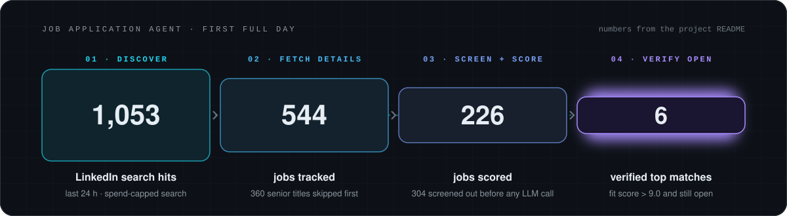

<!--
  Profile README for github.com/MallikarjunaRaoPotti.
  Images live in ./assets. Long logo= values in badge URLs are base64-encoded inline SVG icons.
-->

<p align="center">
  
</p>

<p align="center">
<a href="https://portfolio-p5o1.vercel.app"></a>
<a href="https://www.linkedin.com/in/mallikarjuna7"></a>
<a href="mailto:mallikarjunraopotti@gmail.com"></a>

</p>

## About me

I'm a Computer Science &amp; IT graduate and an **Engineering Intern at iCustomer**, where most of my days go into validating, cleaning and reporting on production and staging data with SQL and Power BI.

My personal projects follow the same rule: **build the pipeline first**, so the dashboard, the forecast or the model on top of it can actually be trusted. So far that has meant a Databricks medallion lakehouse with Prophet forecasting, a CNN-based accident-detection system that won a project expo, and a local AI job-search agent that enforces honest scoring in code.

- **Now:** interning at iCustomer (since June 2026) and building [`job-application-agent`](https://github.com/MallikarjunaRaoPotti/job-application-agent)
- **Certified:** Microsoft Certified: Fabric Data Engineer Associate (May 2026)
- **Looking for:** data engineering, analytics and applied ML roles

## Tech stack

<table>
<tr>
<td><b>Languages</b></td>
<td>


</td>
</tr>
<tr>
<td><b>Data engineering</b></td>
<td>


</td>
</tr>
<tr>
<td><b>Analytics &amp; BI</b></td>
<td>


</td>
</tr>
<tr>
<td><b>ML &amp; AI</b></td>
<td>


</td>
</tr>
<tr>
<td><b>Backend &amp; apps</b></td>
<td>


</td>
</tr>
<tr>
<td><b>Tooling</b></td>
<td>


</td>
</tr>
</table>

## Featured projects

### 01 · [Job Application Agent](https://github.com/MallikarjunaRaoPotti/job-application-agent)

A local AI agent that finds fresh job postings, screens and scores them against a real resume, and keeps only strong-fit openings that are still accepting applications. Honesty is enforced in code: the model only *suggests* a score.

<p align="center">
  
</p>

- **Multi-source discovery.** LinkedIn, Indeed and Naukri through Apify actors, with item and spend caps on every call and a fallback detail fetcher for jobs the primary scraper drops.
- **Free screening first.** Rule-based filters remove senior roles, staffing agencies and red flags (fees, unpaid work, empty descriptions) before any LLM call is paid for.
- **Scores the model can't inflate.** Rubric scoring through forced tool calling. Python applies the weighted formula and the experience cap, and only counts a matched skill if it is quoted verbatim from the resume.
- **Excel tracker with a live dashboard.** One row per job keyed by a stable hashed ID, atomic saves, and a dashboard sheet with native Excel charts rebuilt on every save.
- **Tested and automated.** 172 passing pytest tests against fake API responses (no network, no cost), a scheduled daily run, and a headless Claude Code fallback when LLM credit runs out.

     

<a href="https://github.com/MallikarjunaRaoPotti/job-application-agent"></a>

### 02 · [E-Commerce Lakehouse on Databricks](https://github.com/MallikarjunaRaoPotti/ecommerce-lakehouse-databricks)

An end-to-end medallion lakehouse that turns raw e-commerce CSVs into a BI-ready star schema, a sales dashboard and a six-month revenue forecast.

<p align="center">
  
</p>

- **Bronze:** schema-enforced CSV ingestion from Unity Catalog Volumes into Delta tables, tagged with source-file lineage and ingest timestamps.
- **Silver:** PySpark cleaning: trimming, regex clean-up, category anomaly mapping, de-duplication on `(order_id, item_seq)`, mixed date and timestamp parsing, and type casting.
- **Gold:** a star schema with customer (region-mapped across 7 countries), product and date dimensions, plus an order-items fact with gross, discount and net sale amounts.
- **Forecast:** a Prophet model trained on monthly gold-layer revenue, with the six-month forecast written back as a Delta table that feeds the Databricks SQL dashboard.

    

<a href="https://github.com/MallikarjunaRaoPotti/ecommerce-lakehouse-databricks"></a>

### 03 · [Intelligent Accident Detection &amp; Real-Time Alerts](https://github.com/MallikarjunaRaoPotti/Intelligent-Accident-Detection-Using-Deep-Learning-and-Real-Time-Alert-Generation-)

🏆 **Project Expo winner.** A computer-vision system that watches a live camera or traffic video, detects accidents frame by frame with a CNN, and raises an alert with evidence attached.

```text
camera / video  →  OpenCV frames  →  CNN classifier  →  confidence > 80%  →  snapshot · buzzer · email alert
```

- **Model:** a 4-block CNN in TensorFlow/Keras (32 → 256 filters, batch normalisation, 22.5M parameters) trained on 791 labelled traffic images at 250×250.
- **Result:** 91.8% best validation accuracy on a held-out set of 98 images, with best-weights checkpointing.
- **Alerting:** saves the frame, sounds a buzzer and emails the location, timestamp and snapshot, with a two-minute cooldown so one incident doesn't flood the inbox.
- **Web version:** a Streamlit app for monitoring uploaded videos in the browser ([`MalliACC`](https://github.com/MallikarjunaRaoPotti/MalliACC)).

    

<a href="https://github.com/MallikarjunaRaoPotti/Intelligent-Accident-Detection-Using-Deep-Learning-and-Real-Time-Alert-Generation-"></a>

### 04 · [Customer Shopping Analytics Pipeline](https://github.com/MallikarjunaRaoPotti/customer-shopping-analytics)

ETL and analysis on a messy 99,957-row retail dataset, ending in a clean, analysis-ready dataset and a set of business insights.

- **Clean-up:** removed 478 duplicates, 150 age outliers and 100 negative prices, filled 500 missing values, parsed mixed date formats and standardised text fields.
- **Output:** min-max normalised age and price with scikit-learn, giving 98,729 clean rows.
- **Insights:** monthly sales trend, spend by age group, and payment method by category, with clothing the top category at 31M+ in sales.

   

<a href="https://github.com/MallikarjunaRaoPotti/customer-shopping-analytics"></a>

## More projects

| Project | What it does | Built with |
| :-- | :-- | :-- |
| [SumSnap AI](https://github.com/MallikarjunaRaoPotti/SumSnap--AI) | Streamlit app that scrapes a web page, summarises it with LSA and exports a PDF | Python, Streamlit, BeautifulSoup, Sumy, NLTK, ReportLab |
| [SQL Practice](https://github.com/MallikarjunaRaoPotti/sql-practice) | 20 solved problems: joins and null traps, `GROUP BY`/`HAVING`, window functions, CTEs, subqueries | Databricks SQL |
| [Kirana Shop App](https://github.com/MallikarjunaRaoPotti/kirana-shop-app) | Product catalogue web app for a neighbourhood grocery store | Java 17, Spring Boot 3.5, Spring Security, JPA, Thymeleaf, H2 |
| [Cloud Task Manager](https://github.com/MallikarjunaRaoPotti/cloud-task-manager) | REST API for creating and listing tasks | FastAPI, SQLAlchemy, Pydantic, SQLite |
| [Portfolio](https://github.com/MallikarjunaRaoPotti/portfolio) | Personal site with a serverless contact endpoint and a honeypot spam check | HTML, CSS, Python, Vercel |
| [Data Analysis Projects](https://github.com/MallikarjunaRaoPotti/data-analysis-projects) | Amazon data analysis report | Power BI |

## Experience &amp; credentials

**Engineering Intern · iCustomer** <sub>June 2026 – present</sub><br/>
Data validation, cleaning and reporting across production and staging datasets with SQL and Power BI, working with engineering and data teams to keep pipelines accurate and consistent.

**Microsoft Certified: Fabric Data Engineer Associate** <sub>May 2026</sub><br/>
Credential ID `BEB4D617C60F16A9`

**B.Tech, Computer Science &amp; IT · QIS College of Engineering and Technology, Ongole** <sub>2022 – 2026</sub><br/>
CGPA 8.4 · Also certified in Python Programming (CodeTantra) and Java Programming (Infosys Springboard)

**🏆 Project Expo winner**<br/>
AI-integrated accident detection and alert system built on traffic CCTV footage

## GitHub activity

<p align="center">
  
  
</p>

## Let's connect

Open to opportunities in data engineering, analytics and applied ML. Email or LinkedIn is the fastest way to reach me.

<p align="center">
<a href="https://portfolio-p5o1.vercel.app"></a>
<a href="https://www.linkedin.com/in/mallikarjuna7"></a>
<a href="mailto:mallikarjunraopotti@gmail.com"></a>
</p>

<p align="center">
  
</p>
